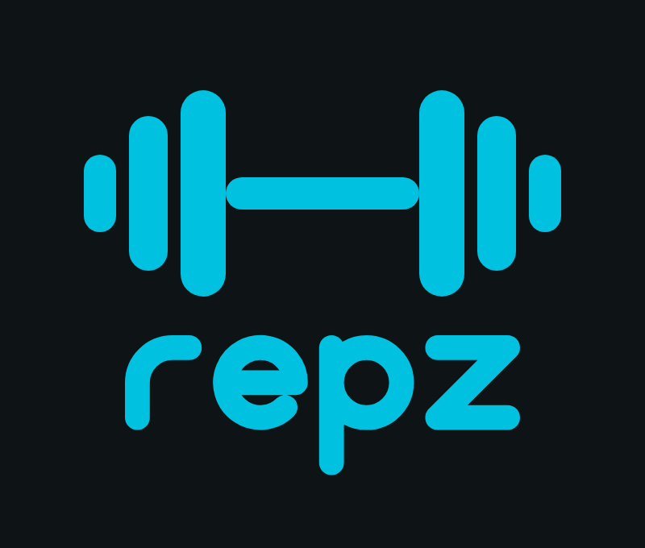

# Repz

 

**Log a set in two taps. Celebrate the PRs. Train in a basement with no signal.**

Repz is an offline-first workout logger for **Android and iOS**, built with **Compose Multiplatform** and backed by a custom **TypeScript API**. It's a portfolio project: modern stack, rich Material 3 Expressive motion, and a codebase that stays boring to read.

> 🚧 Work in progress. Architecture and design are done; implementation is tracked in Linear (team `REP`).

## Highlights

- **Offline-first sync:** Room 3 is the single source of truth. Writes go to an outbox and sync in the background (WorkManager on Android, BGTaskScheduler on iOS) with last-write-wins per aggregate and sticky tombstones.
- **Clean architecture:** feature modules (`api`/`impl`), a pure-Kotlin domain, MVI-lite, Koin with compile-time graph checks, and architecture rules enforced by Konsist.
- **Navigation 3**, Material 3 Expressive (shape morphing, spring motion), and a logo that assembles itself plate by plate.
- **Own API:** Hono + Zod/OpenAPI + Drizzle + Postgres, JWT auth with rotating refresh tokens, and an OpenAPI contract tested on both sides.
- **AI-ready repo:** `AGENTS.md` plus task skills in `.claude/skills`, built on one rule: *never guess, ask*.

## Docs

| | |
|---|---|
| [Architecture](docs/ARCHITECTURE.md) | modules, sync, API, stack & versions |
| [ADRs](docs/adr/) | every decision and why |
| [Design system](docs/DESIGN_SYSTEM.md) · [Motion](docs/MOTION.md) · [Logo](brand/LOGO.md) | tokens, components, screens, MOT-01…29 |
| [AGENTS.md](AGENTS.md) | how to work in this repo (humans and agents) |

## Stack

Kotlin 2.4 · Compose Multiplatform 1.12 · Material 3 Expressive · Navigation 3 · Room 3 · Koin 4.2 (compiler plugin) · Ktor 3 · WorkManager · DataStore · Kermit · Konsist · Detekt 2 / ktlint
Node 26 · TypeScript 7 · Hono 4 · Zod 4 · Drizzle · Postgres 18 · jose · argon2 · Vitest · Biome

## Credits

Exercise data from [wger.de](https://wger.de) (CC-BY-SA 4.0). Fonts: Archivo and Inter (SIL OFL 1.1).
