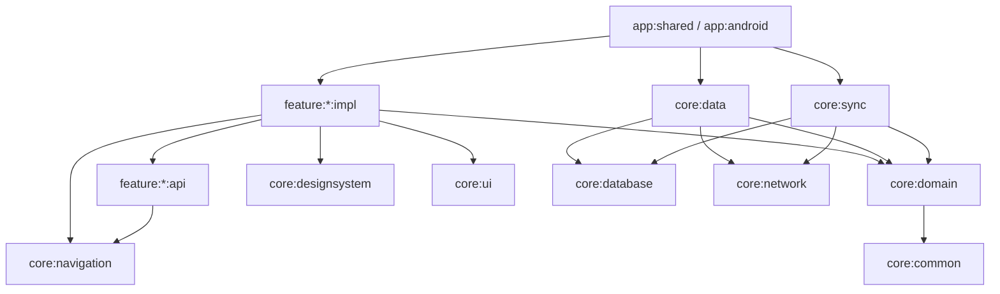

# Repz — Architecture

> Status: **v0.2** (2026-10-28). Decisions are recorded in [`adr/`](adr/). Visual and motion specs: [`DESIGN_SYSTEM.md`](DESIGN_SYSTEM.md), [`MOTION.md`](MOTION.md), [`../brand/LOGO.md`](../brand/LOGO.md).

Repz is an **offline-first workout logger** for Android and iOS built with Compose Multiplatform, backed by a custom TypeScript API.
The goal of this codebase is to be **impressive and boring at the same time**: modern stack, rich motion, but code that a new developer (or an AI agent) understands in minutes.

---

## 1. Product scope (v1)

| Area | What the user can do |
|---|---|
| **Auth** | Register / log in with email + password. Session survives restarts (refresh token). Log out. |
| **Live workout** | Start an empty workout or from a template, add exercises, log sets (weight, reps, optional RPE, set type), rest timer between sets, finish → summary with PRs. The rest timer is stored as `restEndsAt`. When it ends, a **scheduled local notification** fires (Android `AlarmManager`, iOS `UNUserNotificationCenter`), so it works with the app in the background. |
| **Exercise library** | Browse & search the global catalog (served by the API, cached locally), filter by muscle group / equipment, create custom exercises. |
| **History & progress** | List of past workouts, workout details, per-exercise progress charts (est. 1RM, top set, volume), personal records. |
| **Templates** | Create / edit / delete routines (e.g. Push / Pull / Legs), start a workout from a template in one tap. |
| **Settings** | Units (kg/lb), theme (system/light/dark), dynamic color toggle (Android 12+), default rest time, haptics on/off, language (system/EN/PL; on iOS it opens system Settings), sync status, about & licenses, log out. Weekly workout goal is stored in preferences (default 4); its settings UI is still an open question. |

Everything works **without network**. Network is only needed for login/registration and for syncing.

**Out of scope for v1:** social features, password reset (no email service locally), wearables, exercise videos, web/desktop targets.

---

## 2. Repository layout (monorepo)

```
repz/
├── AGENTS.md                    # Single source of truth for AI agents (CLAUDE.md just imports it)
├── CLAUDE.md                    # → @AGENTS.md
├── docs/
│   ├── ARCHITECTURE.md          # this file
│   ├── adr/                     # Architecture Decision Records (one decision per file)
│   ├── DESIGN_SYSTEM.md         # tokens, components, screens (from design v0.2)
│   ├── MOTION.md                # springs, haptics, MOT-01…29
│   └── design/                  # prompts used with Claude Design
├── brand/                       # logo generators + exported logo/app-icon files (LOGO.md)
├── design/                      # git-ignored: local Claude Design export + unpacked boards
├── .claude/skills/              # new-feature, new-endpoint, sync-entity, animation, design-system, verify
├── .github/workflows/           # mobile.yml, api.yml
├── docker-compose.yml           # postgres + api
├── api/                         # TypeScript backend (pnpm)
└── mobile/                      # Gradle root for KMP
    ├── build-logic/             # convention plugins
    ├── gradle/libs.versions.toml
    ├── app/
    │   ├── android/             # com.android.application – thin Android entry (MainActivity, Application)
    │   └── shared/              # KMP umbrella: App(), root navigation, Koin graph, iOS framework export
    ├── iosApp/                  # Xcode project – thin SwiftUI host + BGTaskScheduler registration
    ├── core/
    │   ├── common/              # Result/AppError, DispatcherProvider, Clock & Id providers
    │   ├── domain/              # models, repository interfaces, shared use cases (pure Kotlin)
    │   ├── data/                # repository implementations (Room + outbox)
    │   ├── database/            # Room KMP: entities, DAOs, migrations
    │   ├── network/             # Ktor client, DTOs, auth plugin, API services
    │   ├── sync/                # SyncEngine, outbox processing, platform schedulers
    │   ├── datastore/           # user preferences, token storage
    │   ├── designsystem/        # theme, tokens, components, motion primitives
    │   ├── ui/                  # MVI helpers, shared UI utils, formatters
    │   ├── navigation/          # Navigator, top-level destinations, NavKey serialization
    │   └── testing/             # fakes, test dispatchers, fixtures
    └── feature/
        ├── auth/{api,impl}
        ├── workout/{api,impl}       # live session + finish summary
        ├── exercises/{api,impl}     # library + custom exercises
        ├── history/{api,impl}       # history, details, progress charts, PRs
        ├── templates/{api,impl}
        └── settings/{api,impl}
```

Identifiers: package / applicationId / bundle id **`com.repz.app`**. Minimum OS: **Android 10 (API 29)**, **iOS 18**.

Why two separate app modules? With the current Android Gradle Plugin, the Android application module can no longer be the KMP module itself, so `app/android` is a thin shell and all shared code lives in `app/shared`.

---

## 3. Layers & dependency rules



**Rules (enforced by Konsist tests in CI, not by good intentions):**

1. `core:domain` is pure Kotlin. No Room, Ktor, Compose, Koin or `androidx.*` imports.
2. `feature:*:impl` **never** depends on another `feature:*:impl`. Cross-feature navigation goes only through `feature:*:api` (`NavKey`s).
3. `feature:*:impl` never depends on `core:data`, `core:database` or `core:network`. It sees only domain interfaces.
4. Only `app:shared` knows about every module. It is the **composition root**: it builds the Koin graph and the navigation.
5. DTOs (`core:network`) and entities (`core:database`) never leak outside `core:data` / `core:sync`. Mapping is explicit (`toDomain()`, `toEntity()`, `toDto()`).

### SOLID in practice (what to point at in an interview)

| Principle | Where it shows |
|---|---|
| **S**ingle responsibility | One use case = one class with `operator fun invoke`. ViewModel only maps intents → use cases → state. |
| **O**pen/closed | Sync is driven by a `SyncHandler` registry: adding a new syncable entity means **adding** a handler, not editing the engine (same on the server). |
| **L**iskov | Repositories have fakes in `core:testing` that honour the same contract and are verified by shared contract tests. |
| **I**nterface segregation | Small interfaces: `WorkoutReader` / `WorkoutWriter`, `SyncScheduler`, `TokenStore`, `Clock`, `IdGenerator`. |
| **D**ependency inversion | Domain defines interfaces; data/sync implement them; Koin wires them in the composition root. |

---

## 4. Domain model

```
User(id, email, displayName, unitSystem)

Exercise(id, name, primaryMuscle, secondaryMuscles, equipment, isCustom)

WorkoutTemplate(id, name, notes, exercises: List<TemplateExercise>)
  TemplateExercise(exerciseId, order, targetSets, targetReps: IntRange?, restSeconds)

Workout(id, templateId?, name, startedAt, finishedAt?, notes, exercises: List<WorkoutExercise>)
  WorkoutExercise(id, exerciseId, order, notes, sets: List<WorkoutSet>)
    WorkoutSet(id, order, weight: Weight, reps, rpe?, type: WARMUP|NORMAL|DROP|FAILURE, completedAt?)

PersonalRecord(exerciseId, type: EST_1RM|HEAVIEST|BEST_SET_VOLUME|MOST_REPS, value, workoutId, achievedAt)
```

Decisions:

- **IDs are generated on the client** (UUID). This is a hard requirement of offline-first, because entities must exist before the server knows about them.
- **Weight is stored in grams** (`Long`) inside a `Weight` value class. That gives exact arithmetic with no float drift. kg/lb exists only at the presentation layer.
- **Aggregates:** `Workout` (with exercises and sets), `WorkoutTemplate` and custom `Exercise` are aggregate roots. **The aggregate is the unit of sync.**
- **Personal records are derived data.** They are recomputed locally (`RecalculatePersonalRecordsUseCase`) after a workout finishes or after a sync pull, and they are never synced. Est. 1RM uses the Epley formula.
- **Time:** `kotlin.time.Clock` and `Instant` are injected, so tests are deterministic.

---

## 5. Offline-first & sync

### 5.1 Principles

1. **The UI reads only from Room** (`Flow`). The network never pushes data straight to the UI.
2. **Every write is local first:** `entity upsert + outbox entry` happen in **one Room transaction**.
3. Sync runs in the background and is **idempotent**, so running it twice is harmless.
4. **One shared `SyncEngine`** in `commonMain`. Platforms only decide *when* it runs.

### 5.2 Local schema additions

Every syncable root table has:

| Column | Meaning |
|---|---|
| `id` | client UUID |
| `server_version` | `Long?` version last seen from the server (`null` = never synced) |
| `is_deleted` | tombstone (soft delete) |
| `updated_at` | local timestamp (for UI/sorting only, **never** for conflict resolution) |

`outbox` table: `entity_type`, `entity_id`, `operation (UPSERT|DELETE)`, `created_at`, `attempts`.
At most **one pending entry per entity** (coalescing): ten edits to one workout produce one push.
`sync_meta` table: `pull_cursor`, `last_successful_sync_at`.

### 5.3 Algorithm

```mermaid
sequenceDiagram
    participant UI
    participant Repo as Repository
    participant DB as Room
    participant Engine as SyncEngine
    participant API

    UI->>Repo: finishWorkout()
    Repo->>DB: tx { upsert workout; upsert outbox }
    Repo->>Engine: scheduler.requestSync()
    Note over Engine: WorkManager / BGTask (network constraint)
    Engine->>DB: read outbox (batch)
    Engine->>API: POST /sync/push (aggregates)
    API-->>Engine: accepted [id → newVersion]
    Engine->>DB: tx { set server_version; delete outbox rows }
    Engine->>API: GET /sync/pull?cursor=N
    API-->>Engine: changes (version > N), nextCursor, hasMore
    Engine->>DB: tx { apply changes; save cursor }
    Engine->>DB: recalculate PRs for touched exercises
```

**Push first, then pull.** The client never loses its own pending changes.

### 5.4 Conflict resolution: last write wins per record (aggregate)

- The server keeps one global Postgres sequence `sync_version_seq`. Every accepted write gets the next value.
- **"Last write" means last write *to reach the server*.** We never trust client clocks, so clock skew cannot corrupt data.
- When pulling, the client **skips** incoming changes for entities that still have a pending outbox entry. The local edit is pushed next and wins, which is consistent with arrival-order LWW.
- **Delete wins:** once a tombstone exists on the server, a later upsert of that ID is ignored and the tombstone is returned on the next pull. This prevents "zombie" records.
- **Active (unfinished) workout is local-only.** It enters the outbox when it is finished. This removes most of the realistic conflicts and avoids sync traffic during a session.

### 5.5 Initial sync (new device / reinstall)

The device keeps a **full local replica** of the user's data. Personal workout data is bounded: 5 years of 5 workouts/week is about 1,300 workouts and 30k sets, which is a few MB. A full replica keeps the whole history and every PR available offline.

- After login, `pull_cursor = 0`. The engine loops `GET /sync/pull?cursor=…&limit=500` until `hasMore == false`, applying **each page in its own transaction**. If the app is killed, the next run resumes from the saved cursor.
- PRs are recalculated **once** at the end of the initial sync rather than per page.
- The UI shows a dedicated **"Restoring your history" screen** with progress (pages are counted against the server-provided `totalEstimate`).
- History screens read from Room. Lightweight summary projections are enough for v1. Paging 3 (Room `PagingSource`) is the upgrade path if lists grow.

### 5.6 Scheduling

| Trigger | Android | iOS |
|---|---|---|
| After a local write | `WorkManager` unique one-time work (`KEEP`), `NetworkType.CONNECTED`, exponential backoff | Run immediately if online; otherwise wait for the next trigger |
| App foreground | one-time work | `SyncEngine.sync()` from `scenePhase == .active` |
| Periodic | `PeriodicWorkRequest` every 1 h with network constraint | `BGAppRefreshTask` (best effort, system decides) |
| Connectivity regained | covered by the WorkManager constraint | `NWPathMonitor` → sync |

`SyncScheduler` is an interface in `core:domain`. `core:sync` has `AndroidSyncScheduler` (WorkManager) and `IosSyncScheduler` (BGTaskScheduler). Both call the same `SyncEngine`.

### 5.6 Sync status in the UI

`SyncEngine` exposes `StateFlow<SyncStatus>` (`Idle(lastSyncedAt) | Syncing | Offline(pendingCount) | Error(reason)`). The design system has an animated **sync indicator** component for it.

### 5.7 Logout

Logout **wipes the local database** (data belongs to a user). If the outbox is not empty, the user sees a confirmation: *"N changes haven't been synced yet."*

---

## 6. Mobile tech stack

> Exact versions: see §11 (filled in from verified sources and kept in `libs.versions.toml`).

| Concern | Choice |
|---|---|
| Language / UI | Kotlin 2.x, Compose Multiplatform, Material 3 (Expressive) |
| Navigation | Navigation 3 (JetBrains multiplatform artifacts) |
| DI | Koin + **Koin Compiler Plugin** (annotations, compile-time graph verification) |
| Database | **Room 3** (`androidx.room3`, KSP) + bundled SQLite driver |
| Background work | WorkManager (Android), BGTaskScheduler (iOS) |
| Networking | Ktor client + kotlinx.serialization, Ktor `Auth` plugin (bearer + refresh) |
| Preferences | DataStore Preferences (multiplatform) |
| Secure storage | Android: Keystore-backed encryption, iOS: Keychain (behind `TokenStore`) |
| Images | Coil 3 (only if exercise images are added) |
| Logging | Kermit |
| Resources / i18n | Compose Multiplatform Resources: EN (default) + PL |
| Collections in UI state | kotlinx-collections-immutable |
| Testing | kotlin.test, Turbine, coroutines-test, hand-written fakes (no mocking framework) |
| Static analysis | Detekt + Compose rules, ktlint, Konsist |

---

## 7. Presentation: MVI-lite

Each screen has exactly these pieces (generated by the `new-feature` skill):

```kotlin
// UiState: immutable, everything the screen needs to render
data class HistoryUiState(
    val isLoading: Boolean = true,
    val workouts: ImmutableList<WorkoutSummaryUi> = persistentListOf(),
)

// Intent: everything the user can do
sealed interface HistoryIntent {
    data class WorkoutClicked(val id: WorkoutId) : HistoryIntent
    data object RefreshRequested : HistoryIntent
}

// Effect: one-off events (navigation, snackbar, haptics)
sealed interface HistoryEffect {
    data class OpenWorkout(val id: WorkoutId) : HistoryEffect
}

class HistoryViewModel(
    observeHistory: ObserveWorkoutHistoryUseCase,
    private val requestSync: RequestSyncUseCase,
) : ViewModel() {
    val state: StateFlow<HistoryUiState> = /* use case flow → map → stateIn(WhileSubscribed(5s)) */
    val effects: Flow<HistoryEffect> = /* Channel(BUFFERED).receiveAsFlow() */
    fun onIntent(intent: HistoryIntent) { /* when(intent) … */ }
}
```

- **`HistoryScreen`** (stateful) gets the ViewModel from Koin, collects state with `collectAsStateWithLifecycle()`, and handles effects.
- **`HistoryContent`** (stateless) takes `state` and `onIntent`. Every visual state has a `@Preview`. Screenshot tests attach here later.
- No base-class inheritance chains. At most a tiny helper for the effect channel in `core:ui`.

---

## 8. Navigation 3

- `feature:x:api` contains only `@Serializable` route keys (`data object HistoryRoute : NavKey`, `data class WorkoutDetailsRoute(val id: String) : NavKey`) and **registers them itself**: it exposes one `val xNavKeySerializers: SerializersModule` built with `navKeySerializers { subclass(…) }`. `app:shared` combines all of them with `+`. `core:navigation` never sees feature keys, because that would be a dependency cycle.
- `feature:x:impl` declares its entries: `fun EntryProviderScope<NavKey>.historyEntries(navigator: Navigator)`. `app:shared` hosts `NavDisplay` and wires every feature's entries into it. The serializers module needs `import kotlinx.serialization.modules.plus` to combine with `+`.
- `core:navigation` holds the `Navigator`: **a separate back stack per top-level tab** (Train / History / Exercises / Profile; the Profile tab is served by `feature:settings`), plus the auth gate.
- The whole navigator is **one saved object** (`NavigatorState`: auth flag, selected tab, all stacks) saved through a `SavedStateConfiguration` with the combined polymorphic `SerializersModule`. Kotlin/Native has no reflection, so explicit registration is required on iOS. Everything restores atomically.
- The **visible stack** is the Train stack plus the selected tab's stack (when the selected tab isn't Train). Back from another tab's root is then a plain pop, and predictive back shows Train underneath.
- Navigator rules (fixed by unit tests in `core:navigation`):
  - (a) switching tabs keeps every tab's back stack;
  - (b) tapping the already selected tab pops it to its root;
  - (c) Back on the root of History/Exercises/Profile goes to Train with Train's stack kept; Back on Train's root is not handled (Android leaves the app);
  - (d) after sign-in all tab stacks start at their roots with Train selected; after sign-out all tab stacks are cleared and the auth stack restarts at its root;
  - (e) navigating to the key already on top is ignored (no double push on a double tap);
  - (f) after process death everything is restored, including the selected tab and the auth stack.
- Transitions are defined once in the design system's motion spec and applied globally. Predictive back is supported on Android.

---

## 9. Dependency injection (Koin + Compiler Plugin)

- The `repz.koin` convention plugin applies the compiler plugin (`io.insert-koin.compiler.plugin`) and the `koin-core`/`koin-annotations` runtime to every module with Koin definitions: `app:shared`, `core:testing` and the six `feature:*:impl` modules (via `repz.kmp.feature.impl`). `core:domain` and `core:common` never see Koin.
- Every Gradle module with definitions exposes **one** `@Module` class whose bindings are explicit `@Single`/`@Factory` provider functions declared inside it, e.g. `@Module class HistoryModule { @Factory fun observeWorkoutHistoryUseCase(...) = ObserveWorkoutHistoryUseCase(...) }`. `@KoinViewModel fun` providers follow the same shape, but using one as a cross-module provider on Kotlin/Native is unverified until REP-28 confirms it. No cross-module `@ComponentScan`: on Kotlin 2.4.20+ the Koin compiler plugin's `@ComponentScan` hints are dropped by the Kotlin/Native KLIB serializer across Gradle module boundaries (koin-compiler-plugin#106 / KT-79565, found and verified in REP-7), so a definition scanned in one module is invisible when another module compiles against it. `app:shared` is the exception: its own module and the `@KoinApplication` entry point always compile together, so it may keep a local `@ComponentScan("com.repz.app.shared")`. Re-checked in REP-58 once koin-compiler-plugin 1.2.2 (PR #129) ships the fix.
- Shared `core:domain` use cases and `core:common` platform primitives (`Clock`, `IdGenerator`, dispatchers) are provided from `app:shared`, not from `core:domain`/`core:common` themselves (which stay Koin-free): a `DomainModule` for the former, a `CommonModule` for the latter (both land with REP-23). Features provide only their own feature-local use cases. **Each definition has exactly one owner** — Koin resolves a duplicate binding last-wins at runtime, and the compiler plugin isn't verified to flag that at compile time (a Konsist rule is a REP-9 candidate).
- Platform-specific bindings (WorkManager, Keychain, Room builder) are provided through `expect`/`actual` classes in the module's platform source sets.
- `app:shared` is the only entry point: `@KoinApplication(modules = [AppModule::class, ...]) object RepzApp`, started via `startRepzKoin()` (wraps `startKoin<RepzApp>()`). New `@Module` classes are added to `RepzApp`'s explicit `modules` list, never auto-discovered (no `@Configuration`). Android calls `startRepzKoin` from `Application`, iOS from the SwiftUI `App` init (REP-11).
- **The full graph is verified at compile time** (missing bindings, cycles, qualifier clashes) by `app:shared`'s per-platform main and test compile tasks — not its common-metadata compile — so a broken graph does not compile and no runtime `verify()` test is needed. Leaf modules without an entry point get no compile-time diagnostics. Those per-platform tasks cache normally (UP-TO-DATE on an unchanged rebuild). This also auto-enables `strictSafety`, which keeps `app:shared`'s common-metadata compile task from ever reporting up-to-date; that task itself runs no graph check (verified in REP-7).
- Rule for readability: a module's one `@Module` class holds every binding as an explicit `@Single`/`@Factory`/`@KoinViewModel fun` provider — not only for third-party objects (Ktor `HttpClient`, Room database), which was the pre-REP-7 convention.

---

## 10. Backend (`api/`)

### 10.1 Stack

Node.js LTS · TypeScript (strict) · Hono + `@hono/zod-openapi` · Zod · Drizzle ORM + drizzle-kit migrations · Postgres (docker) · JWT · argon2 password hashing · Vitest · pnpm.
API docs: OpenAPI generated from Zod schemas, served at `/openapi.json`, with an interactive UI at `/docs`.

### 10.2 Structure

```
api/src/
├── index.ts                 # server bootstrap
├── app.ts                   # composition root: builds services, mounts routes
├── env.ts                   # Zod-validated environment
├── db/
│   ├── schema/              # one file per table group
│   ├── migrations/
│   └── seed/                # exercise catalog snapshot (wger.de, CC-BY-SA) + seeder
├── scripts/import-wger.ts   # one-off import: wger API → normalized snapshot JSON (committed)
├── modules/
│   ├── auth/      {routes, service, repository, schemas}.ts
│   ├── users/
│   └── sync/
│       ├── sync.routes.ts
│       ├── sync.service.ts
│       └── handlers/        # SyncHandler per entity: workouts, templates, exercises
└── shared/                  # error handler, auth middleware, request id, logger
```

Layers: **routes** (HTTP + validation) → **service** (business rules) → **repository** (Drizzle). Dependencies are wired through plain factory functions in `app.ts`, with no DI framework.

### 10.3 Endpoints

| Method | Path | Notes |
|---|---|---|
| POST | `/auth/register` | email, password, displayName → tokens |
| POST | `/auth/login` | → `{ accessToken (15 min), refreshToken (30 d) }` |
| POST | `/auth/refresh` | **rotation**; reusing an old refresh token revokes the whole token family |
| POST | `/auth/logout` | revokes refresh token family |
| GET / PATCH | `/me` | profile, unit system |
| POST | `/sync/push` | `{ changes: [{ type, id, deleted, payload }] }` → `{ accepted: [{ id, version }] }` |
| GET | `/sync/pull` | `?cursor=&limit=` → `{ changes, nextCursor, hasMore }` (includes global exercise catalog) |
| GET | `/health` | liveness |

**Exercise catalog:** imported from [wger.de](https://wger.de) (CC-BY-SA 4.0) by a one-off script into a **committed snapshot**. The seed is deterministic and there is no runtime dependency on wger. Attribution appears in the README and on the app's About screen. Catalog rows carry `license` and `author` fields.

**Exercise illustrations (every exercise has one):**
- The catalog is **curated to ~150 exercises** from wger (the most common movements, with EN + PL names). That keeps a consistent hand-checked illustration per exercise realistic.
- Each catalog exercise gets an **AI-generated illustration** in one art style defined in the Claude Design pass. Generation uses a fixed style prompt plus per-exercise variables, through a script `api/scripts/generate-illustrations.ts`. Outputs are reviewed by hand and committed as WebP.
- The API serves them as static files (`/static/exercises/{id}.webp`) with immutable cache headers, and `imageUrl` is part of the exercise payload.
- **Offline:** Coil 3 disk cache. After the initial sync, a low-priority job prefetches all catalog images, so the library looks complete without network.
- **Custom (user) exercises** get an illustration for their primary muscle group (about 12 generic illustrations in the same style, bundled in the app as Compose resources). Nothing is ever shown without an image.

Errors use **RFC 9457 Problem Details** (`application/problem+json`) everywhere.

### 10.4 Database

`users`, `refresh_tokens (hashed, family_id, revoked_at)`, `exercises (owner_id NULL = global)`, `workout_templates`, `template_exercises`, `workouts`, `workout_exercises`, `workout_sets`.
Every root table has `user_id`, `version bigint` (from `sync_version_seq`), `deleted_at`, `updated_at`. A push of an aggregate replaces its children in one transaction.

---

## 11. Versions

Verified 2026-10-28 against Maven Central, Google Maven, GitHub releases and npm. The source of truth is `mobile/gradle/libs.versions.toml` and `api/package.json`.

### Mobile

| Library | Artifact | Version | Notes |
|---|---|---|---|
| Kotlin | `org.jetbrains.kotlin` | 2.4.21 | |
| KSP | `com.google.devtools.ksp` | 2.3.12 | versioning decoupled from Kotlin since 2.3.0; needed for Room |
| Compose Multiplatform | `org.jetbrains.compose` | 1.12.2 | ships Material3 **1.12.0-alpha03** (M3 Expressive APIs are available in `commonMain`) |
| Navigation 3 | `org.jetbrains.androidx.navigation3:navigation3-ui` | 1.2.0 | use the JetBrains group (androidx `-ui` is Android-only); runtime is `androidx.navigation3:navigation3-runtime` (Google Maven) + `androidx.savedstate:savedstate` 1.4.0 |
| M3 adaptive + Nav3 | `org.jetbrains.compose.material3.adaptive:adaptive-navigation3` | 1.3.0 | list-detail scenes (optional) |
| Lifecycle / ViewModel | `org.jetbrains.androidx.lifecycle:lifecycle-viewmodel-compose`, `-viewmodel-navigation3` | 2.11.0 | |
| Room 3 | `androidx.room3:room3-runtime` / `room3-compiler`, plugin `androidx.room3` | 3.0.3 | KSP per target (`kspAndroid`, `kspIosArm64`, `kspIosSimulatorArm64`); host tests: `sqlite-bundled-jvm` substituted on `androidHostTestRuntimeClasspath` |
| SQLite bundled driver | `androidx.sqlite:sqlite-bundled` | 2.7.1 | |
| WorkManager | `androidx.work:work-runtime-ktx` | 2.12.0 | `androidMain` only |
| Koin | `io.insert-koin:koin-bom`, `koin-core`, `koin-annotations` | 4.2.2 | `koin-bom` unused: both artifacts pin `koin` directly, no `platform()` needed in KMP `commonMain`; `koin-core` + `koin-annotations` applied via `repz.koin` |
| Koin Compiler Plugin | `io.insert-koin.compiler.plugin` | 1.2.1 | officially verified up to Kotlin 2.4.20; on 2.4.21 it warns on every Kotlin compile task, with source, in a module applying `repz.koin` (35 tasks today) but does not block — **verified in REP-7**. Cross-module `@ComponentScan` hints are dropped on Kotlin/Native (koin-compiler-plugin#106); mitigated with explicit provider functions per module (ADR-0008, "option A") |
| Ktor client | `io.ktor` | 3.6.0 | |
| kotlinx.serialization | | 1.12.0 | |
| kotlinx.coroutines | | 1.11.0 | |
| kotlinx-datetime | | 0.8.0 | only for `TimeZone`/`LocalDate`. `Instant`/`Clock` come from stdlib `kotlin.time` |
| kotlinx-collections-immutable | | 0.5.2 | |
| DataStore | `androidx.datastore:datastore-preferences-core` | 1.3.0 | |
| Coil 3 | `io.coil-kt.coil3` | 3.6.3 | exercise images |
| Kermit | `co.touchlab:kermit` | 2.2.0 | |
| AGP | `com.android.application`, `com.android.kotlin.multiplatform.library` | 9.4.0 | KMP library plugin is the recommended path |
| Gradle | | 9.8.2 | |
| Turbine | `app.cash.turbine` | 1.2.1 | |
| Detekt | `dev.detekt` | 2.0.0-alpha.6 | alpha is a deliberate choice: it is the only line with K2 / Kotlin 2.4 support, and it is a dev-only tool. Verified in REP-9: runs its own bundled Kotlin 2.4.10 compiler in an isolated classpath, so it never conflicts with the project's 2.4.21 |
| Compose rules for Detekt | `io.nlopez.compose.rules:detekt` | 0.6.8 | its POM depends on `dev.detekt:detekt-core:2.0.0-alpha.6`, i.e. built for exactly our alpha (REP-9) |
| ktlint Gradle | `org.jlleitschuh.gradle.ktlint` | 14.2.0 | published only to the Gradle Plugin Portal, not Maven Central (`build-logic/settings.gradle.kts` adds `gradlePluginPortal()` to `dependencyResolutionManagement` for it, REP-9) |
| ktlint engine | `com.pinterest.ktlint` | 1.8.0 | pinned explicitly via the ktlint Gradle plugin's `version` property, so the plugin's own default never silently decides it (REP-9) |
| Konsist | `com.lemonappdev:konsist` | 0.18.1 | `KotlinFileParser` rejects `.kts` files outright (confirmed in REP-9); rules that need build-script content read it as plain text instead |
| Roborazzi | `io.github.takahirom.roborazzi` | 1.77.0 | later; iOS support experimental |

### Toolchain

The machine toolchain the mobile build is verified against (checked in REP-5):

| Tool | Version | Notes |
|---|---|---|
| Xcode | 27.1 (27A9275) | kept by user decision; Kotlin 2.4.21 is tested up to Xcode 26.4 |
| macOS | 27.2 | |
| JDK | 17 | Gradle daemon toolchain |
| Android compileSdk / targetSdk | 37 | minSdk 29 |
| iOS simulator runtime | 27.1 | |
| Gradle | 9.8.2 | above Kotlin 2.4.21's tested 9.7.0 |
| AGP | 9.4.0 | above Kotlin 2.4.21's tested 9.3.1; only the `Configuration.setVisible` deprecation observed |

### API

| Item | Version | Notes |
|---|---|---|
| Node.js | 26 (Active LTS) | |
| TypeScript | 7.0.2 | native (Go) compiler |
| pnpm | 12.16.1 | |
| Hono / @hono/node-server / @hono/zod-openapi | 4.13.14 / 2.1.5 / 1.6.3 | |
| Zod | 4.6.7 | |
| Drizzle ORM / drizzle-kit | 0.45.4 / 0.31.11 | 1.0 still RC |
| postgres (postgres.js) | 3.4.9 | driver for Drizzle |
| jose | 6.2.13 | JWT sign/verify |
| @node-rs/argon2 | 2.2.2 | password hashing, no node-gyp |
| Vitest | 5.0.5 | |
| Biome | 2.6.3 | lint + format in one tool |
| Postgres (docker) | 18.6 | |

**API contract:** the OpenAPI spec is generated from Zod (`/openapi.json`) and committed to `api/openapi.json`. Kotlin DTOs are **hand-written** in `core:network`. A CI contract test validates JSON fixtures shared by both sides against the spec, so neither side can drift without the build failing. Generators (openapi-generator `kotlin`/`multiplatform`) produce noisy code that needs fixups, which is not worth it for an API we fully own.

---

## 12. Quality gates

| Gate | Tool | Where |
|---|---|---|
| Kotlin style | ktlint | `./gradlew check` (CI wiring: REP-10) |
| Kotlin static analysis | Detekt + Compose rules | `./gradlew check` (CI wiring: REP-10) |
| Architecture rules | Konsist (`:konsist-tests`, see §3 rules, naming: `*ViewModel`, `*UseCase` with single `invoke`, `*Screen` vs `*Content`) | `./gradlew check` (CI wiring: REP-10) |
| DI graph | Koin Compiler Plugin, full-graph check at compile time | build |
| Unit tests | `commonTest` on the Android host test (`testAndroidHostTest`) + iOS simulator (`iosSimulatorArm64Test`) | `./gradlew check` (CI wiring: REP-10) |
| TS | Biome/ESLint, `tsc --noEmit`, Vitest | CI |

Planned later (optional): Room DAO tests, Ktor `MockEngine` repository tests, sync conflict scenarios, backend Vitest + testcontainers, screenshot tests.

### 12.1 ktlint and Detekt (REP-9)

`repz.quality` (applied by `repz.kmp.library` and `repz.android.application`, and by `:konsist-tests` directly) wires both into every module's `check`:

- **ktlint** (`org.jlleitschuh.gradle.ktlint`, `ktlint_official` style via `mobile/.editorconfig`, 140-char lines) discovers every Kotlin source set itself, KMP (`commonMain`, `androidMain`, `iosMain`, `commonTest`, `androidHostTest`, `iosTest`, …), AGP 9 built-in Kotlin (`app:android`'s `main`/`test`/`androidTest`, with no `org.jetbrains.kotlin.android` plugin needed) and `*.gradle.kts` scripts alike. It also discovers KSP- and Compose-resources-generated Kotlin under each module's own build directory as if it were hand-written source; `repz.quality` excludes files under that module's own build directory (by path, not a `build` substring, so a checkout path containing `build` elsewhere is unaffected) from linting for that reason.
- **Detekt** (`dev.detekt`, Compose rules `io.nlopez.compose.rules:detekt`) runs as the plain, non-type-resolved `detekt` task only — not the per-compilation (`detektMainAndroid`, `detektHostTestAndroid`, …) or per-source-set (`detektCommonMainSourceSet`, …) tasks the alpha also registers, which are not part of `check` by default and are left unused. `source` is set explicitly to every `src/<sourceSet>/kotlin` directory the module has, so coverage does not depend on how the alpha's own discovery handles the AGP 9 KMP library plugin or AGP 9 built-in Kotlin. Runs its own bundled Kotlin 2.4.10 in an isolated classpath; no conflict with the project's Kotlin 2.4.21 was observed.
- Config: `mobile/config/detekt/detekt.yml`, `buildUponDefaultConfig: true`, no baseline. Contains only six overrides: `MaxLineLength` (140, matching ktlint), `MagicNumber` (property declarations exempt — already alpha.6's own default, pinned explicitly so it survives a later alpha changing it), `LongParameterList` (`ignoreDefaultParameters: true`, for Composables with defaulted parameters), `TopLevelPropertyNaming` (`constantPattern` widened to `[A-Z][A-Za-z0-9_]*`, accepting both `UPPER_SNAKE_CASE` constants and PascalCase `CompositionLocal`s/preview vals in the same rule), `FunctionNaming` and `UnusedPrivateFunction` (both `ignoreAnnotated`, see below) — plus the full Compose rule set at its documented defaults.
- `build-logic/convention` cannot apply `repz.quality` (it builds it), so it configures both tools on itself by hand, identically; its own source scan also covers every `src/<sourceSet>/kotlin` it has, not just `src/main/kotlin`.
- Root `mobile/build.gradle.kts` applies `base` (gives the root project a `check` task) and ktlint (lints the root `*.gradle.kts` and `settings.gradle.kts`); its `check` depends on `build-logic`'s own `:convention:check` so the included build is gated too.
- `./gradlew ktlintFormat` auto-fixes formatting; Detekt findings are fixed by hand (`autoCorrect: false`).
- `FunctionNaming.ignoreAnnotated: ['Composable']` and `UnusedPrivateFunction.ignoreAnnotated: ['Preview']`: `ignoreAnnotated` does not appear in the generated default config for either rule because it is a **generic key accepted on every rule** (`dev.detekt.api.Config.Companion`, `ConfigValidationKt`, `AnnotationSuppressorKt`), not a per-rule property — confirmed against the alpha.6 jars. Verified: a `@Composable fun SampleComposable()` and a private `@Composable @Preview fun` are not flagged by `FunctionNaming`, while a plain (non-Composable) PascalCase function still is. A custom multipreview annotation would not need adding to `FunctionNaming`'s list (it is still `@Composable`); it would need adding to `UnusedPrivateFunction`'s `ignoreAnnotated` and to the exact `"Preview"` name match in the S1 and N4 Konsist rules (§12.2).
- **Accepted gap (user, 2026-10-29):** `UnusedPrivateFunction` implements `RequiresAnalysisApi`, so it needs type resolution and never runs in our plain, non-type-resolved `detekt` gate — its `ignoreAnnotated` override is configured for when the gate gains type resolution, but today a private `@Preview` function is simply never checked for being unused (confirmed: an unused private `@Preview` function produced no finding at all). Revisit when Detekt 2.0 is stable.

### 12.2 Konsist rule catalogue (`:konsist-tests`, REP-9)

A plain Kotlin/JVM module, not a KMP one: it reads source **text** (via Konsist for `.kt` files, or directly for `.kts`, which Konsist's `KotlinFileParser` cannot parse at all), so it sees every source set of every module, including `iosMain`/`iosTest`, build-logic and the root build scripts. Fixture trees under `konsist-tests/src/test/fixtures/<ruleId>/` are always excluded, matched by their exact relative path from the project root; A4 and A5 additionally exclude `:konsist-tests` itself, since their own source text could otherwise match their own patterns (C1, N6 and N7 still scan it). Each rule is a function run twice — once against the real tree, once against its fixture(s) — and every sub-check (e.g. T1's five token kinds) has its own fixture and its own assertion message, not just the rule ID. No Konsist exclusion or baseline exists for any rule.

| ID | Rule | Mechanism |
|---|---|---|
| P1 | Main files under `core`/`feature`/`app:shared` declare a package starting with the module's namespace; `app:android` starts with `com.repz.app` | Konsist, `KoFileDeclaration.packagee` |
| A1 | `core:domain` imports nothing from `android.`/`androidx.`/`io.ktor.`/`org.koin.`/`org.jetbrains.compose.`; `core:common` imports nothing from `org.koin.`; neither module's build file applies those plugins | plain text (build files) |
| A2 | A `feature:x:impl` never imports another feature's `:impl`; a `feature:x:api` never imports any `:impl`; no feature build file depends on another feature's `:impl` | plain text |
| A3 | `feature:x:impl`/`feature:x:api` see domain interfaces only, never `core:data`/`core:database`/`core:network`/`core:sync`, incl. their build files | plain text |
| A4 | `@KoinApplication`/`startKoin`/`NavDisplay` are used only in `app:shared`; `core:*` never imports feature or `app:shared` code | plain text, checked by fully qualified name so both `startKoin(...)` and a trailing-lambda `startKoin { ... }` are caught |
| A5 | `@Entity` classes live only in `core:database`, `*Dto` classes only in `core:network`; neither leaks outside `core:database`/`core:network`/`core:data`/`core:sync`, from any subpackage (e.g. `core.database.probe.ProbeEntity`) | plain text (heuristic: text pattern for the annotation/suffix, not a resolved type) |
| T1 | UI files (import `androidx.compose.`) outside `core:designsystem` contain no hard-coded `Color(…)`/`Color.<Name>` (except `Transparent`/`Unspecified`), no `<n>.dp` (except `0.dp`), no `<n>.sp`, no `spring(`/`tween(`, with or without a generic type argument | plain text (heuristic); each token kind is its own sub-check with its own fixture |
| S1 | UI files in `feature:x:impl`/`core:ui`/`core:designsystem`/`app:shared` pass no string literal containing a letter to `Text(` or a `text=`/`contentDescription=`/`placeholder=`/`title=` argument, outside `@Preview` functions (`label=` is exempt: in Compose it is almost always an animation's non-user-facing debug label) | Konsist, per function's own `.text` (precise about the `@Preview` boundary; heuristic about what counts as a forbidden call) |
| D1 | `@ComponentScan` only in `app:shared` | Konsist |
| D2 | `@Single`/`@Factory`/`@Scoped`/`@KoinViewModel` classes only in `app:shared`; `@Singleton` forbidden everywhere | Konsist |
| D3 | At most one `@Module` class per module's main source sets, except `app:shared` | Konsist |
| D4 | Provider functions inside a `@Module` class declare an explicit return type | Konsist |
| D5 | One owner per (return type, qualifier annotations) pair, across provider functions and definition classes; the qualifier key is the full text of annotations other than the Koin definition ones and `@Module`/`@OptIn`/`@Suppress`/`@JvmStatic`, so two `@Named`-qualified definitions of the same type are distinct owners | Konsist (heuristic: return type compared by source text, not a resolved fully qualified name — Konsist does not do type resolution here by design) |
| V1 | `feature:x:api` main files declare only `@Serializable` `NavKey` types (`data object` or `data class`) and exactly one top-level `val <feature>NavKeySerializers` | Konsist |
| N1 | A class extending `ViewModel` is named `*ViewModel` and vice versa; lives in `..presentation..` of a `feature:x:impl`; has `XUiState`/`XIntent`/`XEffect` in the same package; exposes `state`, `effects`, `onIntent` | Konsist |
| N2 | `*UiState` properties are never `List`/`Set`/`Map` | Konsist |
| N3 | `*UseCase` classes live in `core:domain` or `..domain..` of a `feature:x:impl`; declare exactly one non-private function, `operator fun invoke` | Konsist |
| N4 | A `@Composable fun XScreen` has a matching `XContent` in the same package; `XContent` takes `state`/`onIntent`, never a ViewModel parameter, never calls `koinViewModel(` (with or without a generic type argument); that call is allowed only inside `*Screen`; a `@Preview` in the same file calls `XContent(` | Konsist (per-function `.text`) |
| N5 | `*Repository` interfaces live in `core:domain`; a `core:data` implementation is named `OfflineFirst<Interface>`; outside `core:data` only `core:testing`/test source sets may implement one | Konsist |
| N6 | `@Test` functions match `^given.+_when.+_then.+$` | Konsist |
| N7 | No `io.mockk`/`org.mockito` imports | Konsist |
| C1 | A `REP-<n>` key in a comment only ever appears as `TODO(REP-<n>):`; every `TODO` is written exactly that way; upstream tracker references are unrestricted | plain text, incl. `.kts` (its own comment extractor: skips string/char literals, tracks Kotlin's nestable block comments) |

"Plain text" rules read every `.kt`/`.kts` file directly (`RepzTextFile`) rather than through a Konsist `KoScope`, needed wherever a rule must see `.gradle.kts` content.

---

## 13. AI-agent setup

- `AGENTS.md` (root) is a short map: what Repz is, module rules, commands, conventions, and links to docs and skills.
- Skills in `.claude/skills/`: `new-feature`, `new-endpoint`, `sync-entity`, `animation`, `design-system`, `verify`.
- **Every skill and AGENTS.md contains the same rule: "Never guess. If anything is unclear or ambiguous (naming, behaviour, UX, API shape), stop and ask the user before writing code."**

---

## 14. Decision log

All decisions live in [`docs/adr/`](adr/) (ADR-0001 … ADR-0017). Add a new ADR for every decision that changes this document.

## 15. Risks to verify in the first scaffold spike

1. Room 3 KSP wiring with `com.android.kotlin.multiplatform.library` (AGP 9.4) on iOS targets. This is not confirmed by official docs. (REP-6) Verified: KSP generates the `actual` Room code for `kspAndroid`, `kspIosArm64` and `kspIosSimulatorArm64`; the probe DAO suite (suspend query, `Flow`, `withWriteTransaction` rollback) passes on `testAndroidHostTest` and the iOS 27.1 simulator; `androidHostTestRuntimeClasspath` substitutes `sqlite-bundled-jvm` so the bundled driver loads on the host JVM.
2. Koin Compiler Plugin 1.2.1 on Kotlin 2.4.21 (officially verified up to 2.4.20; expected to warn, not fail). (REP-7) — **Checked in REP-7:** warns as expected (`Kotlin 2.4.21 is newer than the newest verified version (2.4.20)...`), never blocks. Found a real bug along the way: cross-module `@ComponentScan` hints are dropped on Kotlin/Native (koin-compiler-plugin#106 / KT-79565, JVM/Android unaffected). Fixed by switching to explicit `@Single`/`@Factory` provider functions per module instead of cross-module scanning (ADR-0008, "option A"); `app:shared` still scans locally. Re-check in REP-58 once plugin 1.2.2 ships.
3. Detekt 2.0 alpha + Compose rules + KMP source sets. (REP-9) — **Checked in REP-9:** no Kotlin-version-mismatch crash (Detekt runs its own bundled Kotlin 2.4.10 in an isolated classpath, confirmed by its daemon running alongside the project's 2.4.21 one; the pre-approved mitigation, forcing the `detekt`/`detektPlugins` configurations to 2.4.10, was not needed). Compose rules load and fire correctly (verified with a deliberate `ComposableNaming` violation). ktlint-gradle 14.2.0 discovers every KMP source set and AGP 9 built-in Kotlin (`app:android`) without hand-wired source dirs; it also picks up KSP- and Compose-resources-generated Kotlin under each module's `build/` directory, which needed an explicit exclude (`repz.quality`, REP-9). Konsist 0.18.1 resolves the project root to `mobile/` correctly, but its `KotlinFileParser` rejects `.kts` files outright (`IllegalArgumentException: File must be a Kotlin file`) even via `scopeFromFile`; rules needing build-script content read it as plain text instead (§12.2). Detekt's `FunctionNaming`/`UnusedPrivateFunction` are both configured with `ignoreAnnotated` (a generic key on every rule, not rule-specific, so it does not appear in the generated default config); verified it excuses `@Composable`/`@Preview` functions precisely while still flagging a plain PascalCase function. `UnusedPrivateFunction` needs type resolution and stays inactive in the plain `detekt` gate regardless (accepted gap, user, 2026-10-29) — see §12.1.
4. Nav3 polymorphic back-stack serialization on iOS. (REP-8) Verified in REP-8: the SavedState round-trip passes on the iOS simulator, and a JSON round-trip passes on the Android host. The Android `Bundle` path (process death, "Don't keep activities") is checked in REP-28.
5. Choice of image-generation tool and art style (decided after the Claude Design pass).
6. Xcode 27.1 / Gradle 9.8.2 / AGP 9.4.0, all above Kotlin 2.4.21's tested toolchain (Xcode 26.4, Gradle 9.7.0, AGP 9.3.1) — checked in REP-5: build, link and simulator tests pass; only the AGP deprecation was seen.

If a spike fails, we **stop and decide together**. No silent fallbacks.
